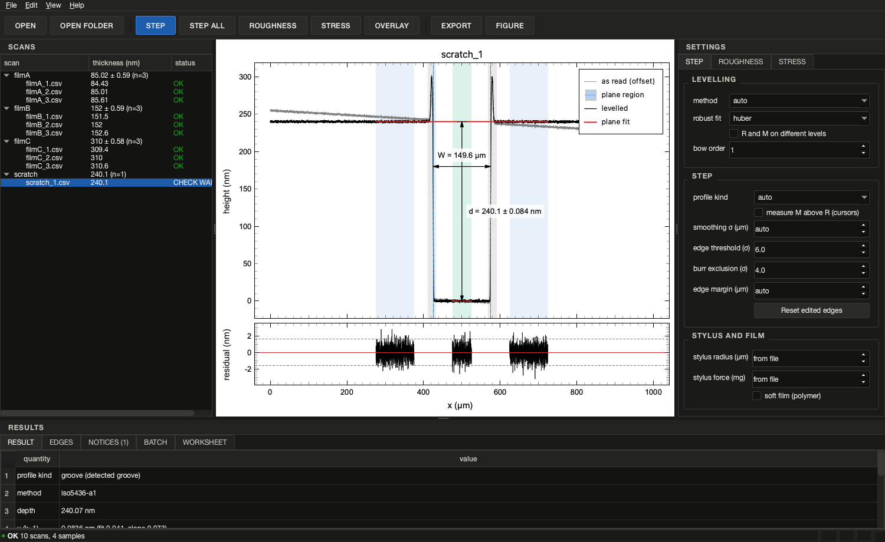
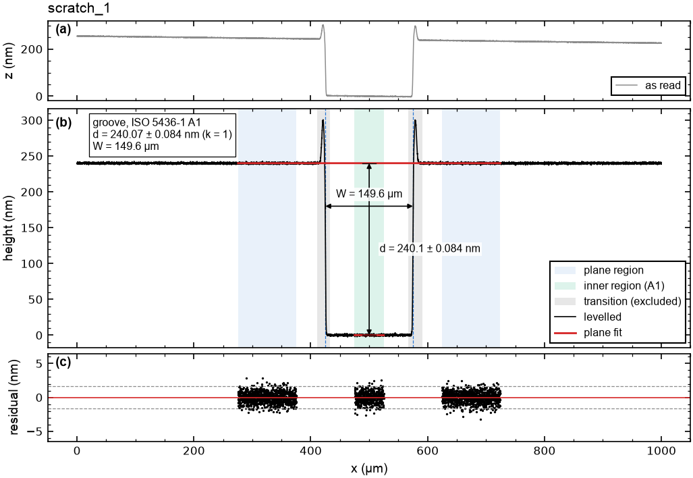
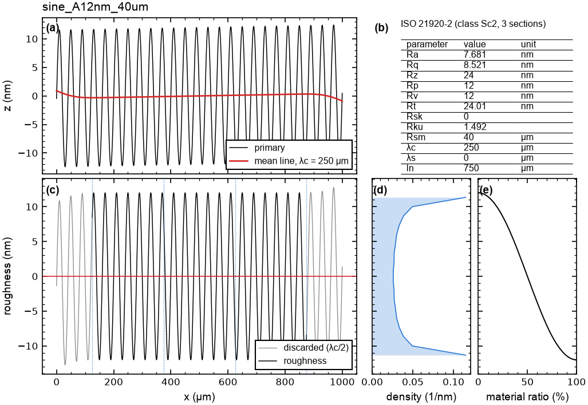
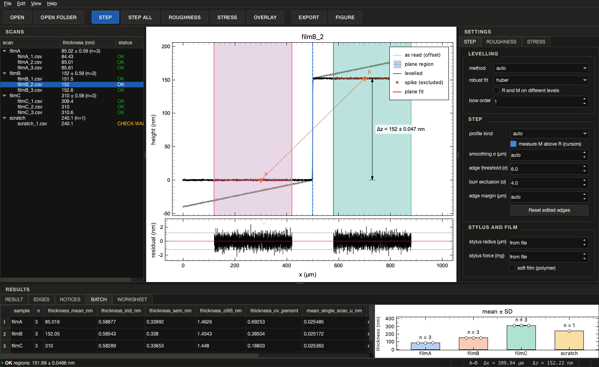
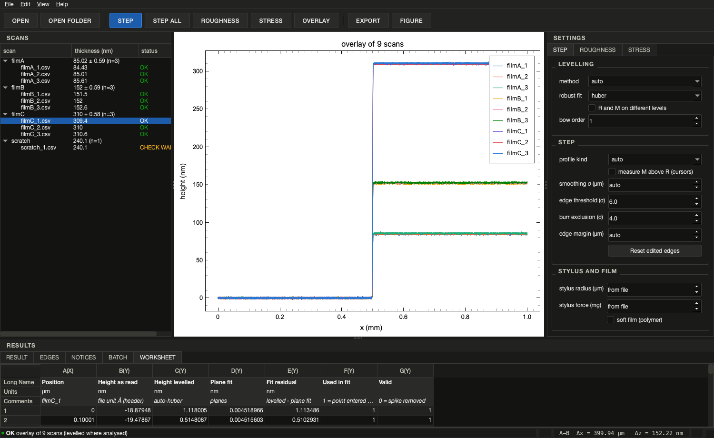

# Profilometry Analyzer

[](https://github.com/jongsu-king/profilometry-analyzer/actions/workflows/ci.yml)
[](LICENSE)

Reproducible **step height / film thickness**, **roughness** and **film stress** from
stylus profilometer line scans. A desktop application and a command-line tool share one
analysis engine; every result is written with its warnings and a project file that
`verify` re-computes. Reads the CSV, TXT and xlsx exports of Dektak-compatible stylus
profilometers (written for a Bruker DektakXT-E) and generic two-column tables.

> **Status: v0.1, alpha.** Validated on synthetic data and analytical cases only.
> **Not yet validated against real instrument scans** (see [Validation](#validation)).



## What it does

| Task | Method |
|---|---|
| Read | CSV / TXT / TSV / xlsx; header and metadata lines found automatically; units from the header (Å, nm, µm, mm) or **assumed with a warning**; stylus force, scan length, speed and stylus radius kept when the file has them. The values as read are never changed. |
| Level | Manual: two reference regions (like the R and M cursors of the instrument software), on one level or on separate levels. Automatic: edges masked by a smoothed derivative, then a robust (Huber or RANSAC) line shared by all plateaus with one offset per plateau. Bow: optional polynomial (order 2–6), a separate, recorded step. |
| Step height | Edge detection from the smoothed derivative against a noise threshold; classification into film edge, groove (scratch), ridge (stripe), staircase, periodic lines. Film edge: a line on each plateau, transition zone (default two stylus radii) excluded, height at the half-height point. Groove and ridge: **ISO 5436-1 type A1** evaluation. Raised burrs beyond k·σ are excluded and reported. |
| Uncertainty | From the regression residuals (inflated by the integrated autocorrelation time of the residuals) and from the slope difference of the two planes; several scans: mean, standard deviation and n per sample. |
| Roughness | ISO 21920-2 Ra, Rq, Rz, Rp, Rv, Rt, Rsk, Rku, Rsm after an ISO 16610-21 Gaussian filter (λs and λc); default cut-offs from the ISO 21920-3 setting classes; warnings for coarse sampling and short evaluation lengths. |
| Film stress | Stoney equation from the curvature of quadratic fits to long scans before and after deposition; substrate table (Si(100), Si(111), glasses) with sources, editable. |
| Batch | Every scan of a folder, grouped by sample from the file name: n, mean, SD, SE, CV and the 95 % confidence interval of the mean (Student t) per sample; column chart with error bars and the individual scans. |
| Output | CSV, xlsx, JSON project file (`verify` repeats the analysis and compares), Origin-ready worksheets, and publication figures (PNG / TIFF / SVG / PDF) - see [Figures and worksheets](#figures-and-worksheets). |

### Warnings

Each result carries coded notices (repeated in every table, figure and project file), for
example `UNIT_ASSUMED`, `NARROW_FEATURE` (structure narrower than the stylus can trace),
`SMALL_STEP` (near the 20 nm lower end of the vertical range), `SOFT_FILM_HIGH_FORCE`
(soft film scanned with more than 3 mg), `BURR_EXCLUDED`, `NONPARALLEL_PLANES`,
`CORRELATED_RESIDUALS`, `EVALUATION_TOO_SHORT`, `SAMPLING_TOO_COARSE`, `STONEY_THICK_FILM`,
`CURVATURE_CHANGE_NOT_SIGNIFICANT`. The full list is in
[`notices.py`](src/profilometry_analyzer/notices.py).

## Install

Installers for Windows, macOS (Apple silicon) and Linux will be attached to each
[release](https://github.com/jongsu-king/profilometry-analyzer/releases). From source
(Python 3.11–3.13):

```bash
pip install "profilometry-analyzer[gui] @ git+https://github.com/jongsu-king/profilometry-analyzer"
```

The package is not on PyPI yet.

## Quick start

```bash
profilometry-analyzer synth --out demo                 # synthetic scans with known values
profilometry-analyzer info demo/filmA_1.csv            # columns, units, scan parameters
profilometry-analyzer step demo/scratch_1.csv -o out   # depth, figure, project file
profilometry-analyzer batch demo -o out/batch          # mean ± s.d. per sample
profilometry-analyzer roughness demo/roughness/sine_A12nm_40um.csv --lc 800 --ls 0
profilometry-analyzer stress --pre demo/stress/wafer_pre.csv --post demo/stress/wafer_post.csv \
    --substrate si100 --hs 525 --hf 500
profilometry-analyzer verify out/scratch_1_step.json
profilometry-analyzer gui
```

Useful options: `--z-unit nm` / `--x-unit um` when the file does not say;
`--level-regions 50:300,700:950` (manual levelling) with `--separate-levels` when one
region is on the film; `--regions 100:400,600:900` (height of the second region above
the first); `--edges 512.3` (edge positions instead of detection); `--mode groove`;
`--bow 2`; `--tip-radius 1.25 --force 2 --soft`.

## Figures and worksheets

Figures follow the look of OriginLab graphs (white canvas, frame on four sides, inward
major and minor ticks, Arial-type labels, red fits, boxed legend) and are built like
Origin multi-layer graphs:

- **Step**: (a) profile as read, (b) levelled profile with plane regions, excluded
  transitions and burrs, plane fits and **dimension lines** with the measured height
  `h`, depth `d` and width `W`, (c) **residuals of the plane fits** with ±2σ lines.
- **Roughness**: (a) primary profile and mean line, (b) parameter table, (c) roughness
  profile with the section boundaries, (d) amplitude distribution, (e) material ratio
  (Abbott-Firestone) curve.
- **Stress**: scans and curvature fits, and the fit residuals.
- **Batch**: column chart of the sample means with SD, SE or 95 % CI error bars, every
  scan as an open symbol, n above each column.





`--figure-size single|onehalf|double|slide` (85, 120, 174 or 240 mm wide) or
`--figure-size 100x70` (mm), `--dpi 600`, `--font-size 8`, `--x-display mm`,
`--z-display Å`, `--no-annotate`, `--no-residuals`, `--error-bar ci95`; `--formats` takes
`png,tiff,svg,pdf`. Text stays text in SVG and PDF (TrueType embedding), so labels can be
edited in Illustrator, Inkscape or Origin.

`--formats origin` writes **Origin-ready worksheets** (`*_origin.csv` and `*_origin.xlsx`):
the first three rows are Long Name, Units and Comments - map them to those header rows
when importing - followed by the data: position, height as read, levelled height, plane
fit, fit residual and flags for a step; primary, mean line and roughness profiles, the
material ratio and amplitude curves and the parameters for roughness; per-sample
statistics with an SD column for error bars for a batch.

## Input files

* **Instrument CSV exports:** read with the generic rules (header and metadata lines
  detected, units from the header). The exact column layout of the Vision64 CSV export
  could not be confirmed from public documents, so no vendor column names are assumed;
  rules for it will be added from real exported files.
* **`OPDx` binary files are not supported in v0.1.** Export the scan as CSV. (Gwyddion
  reads OPDx, but its code is GPL; none of it is used or translated here. Support will
  be written from sample files.)
* Generic CSV / TXT / TSV (comma, semicolon with decimal comma, tab, whitespace;
  UTF-8, CP949, Latin-1) and xlsx.

If the height unit is not in the file, Å is assumed and every output carries
`UNIT_ASSUMED`: a magnitude cannot tell Å from nm, so set `--z-unit`.

## Methods in brief

Details and references: [`docs/methods.md`](docs/methods.md).

* **Edges** – Gaussian-smoothed derivative (σ = one stylus radius by default); an edge
  needs `|dz/dx − median| > 6 σ_d` and a height change above 5× the height noise.
  Plateaus shorter than three stylus radii after the margins are dissolved (burr tops,
  dust, narrow lines) and reported as narrow features.
* **ISO 5436-1 A1** – groove width W between the half-height points, centre c; upper
  level = one line over c ± 1.5 W without the groove and W/3 next to each edge; lower
  level = central third of the groove; depth = upper line minus lower line at c. The
  definition was checked in the ISO 5436 wording quoted by Song & Vorburger, J. Res.
  NIST 96, 271 (1991); ISO 5436-1:2000 notes that wide flat-topped ridges are equivalent.
* **Gaussian filter** – ISO 16610-21 weighting function with α = √(ln 2/π), truncated at
  ±λc; half a cut-off is discarded at each end.
* **Setting classes** – Sc1–Sc5 (λc 0.08–8 mm, λs 2.5–25 µm, largest spacing
  0.5–5 µm) as summarised by Polytec (2023); the ISO 21920-3 text itself was not checked.
  The class is chosen from the measured Ra and the notice says so (the standard chooses
  it from the drawing). Rsm discrimination follows the ISO 4287 convention (10 % of Rz,
  1 % of the section length), labelled as such.
* **Stoney** – `σ_f = E_s/(1−ν_s) · h_s²/(6 h_f) · (1/R_after − 1/R_before)`. Positive =
  **tensile** for scans on the film side (concave surface = positive curvature);
  `--backside` reverses the sign. Si moduli are computed from c11, c12, c44 (Hopcroft,
  Nix & Kenny 2010): Si(100) 180.3 GPa, Si(111) 229.1 GPa. Glass values from the
  manufacturers' data sheets; soda-lime is a typical value marked unverified.

## Validation

Run `python examples/validate_synthetic.py` and `pytest` to repeat these numbers.

**Synthetic data.** Profiles with a known step, tilt, bow, noise, burrs and spikes, traced
with a 2 µm spherical stylus; 30 noise realisations per case, default settings:

| case | true (nm) | mean error | max abs error | share with error < 2u |
|---|---|---|---|---|
| film edge, tilt 0.08 nm/µm, noise 1 nm, 4 spikes | 150 | −0.005 | 0.106 | 97 % |
| film edge, bow 40 nm (bow order 2) | 100 | −0.003 | 0.052 | 97 % |
| scratch (A1), W 180 µm, burrs 80 nm, tilt | 250 | +0.015 | 0.072 | 100 % |
| ridge (A1), W 120 µm | 60 | −0.004 | 0.027 | 100 % |
| periodic lines, period 100 µm | 45 | −0.001 | 0.030 | 100 % |
| film edge, correlated roughness Rq 2 nm (5 µm) | 100 | −0.142 | 2.994 | 80 % |

With white noise the single-scan uncertainty u is well calibrated. With roughness
correlated over a few percent of the plane length u is **too small** (here 80 % instead
of 95 % within 2u); such scans carry `CORRELATED_RESIDUALS`. Use the scatter of several
scans (batch table) as the uncertainty of a film thickness.

**Analytical cases.**

* Sine of amplitude A = 10 nm: Ra = 6.36619 nm (2A/π = 6.36620), Rq = 7.07101 nm
  (A/√2 = 7.07107), Rsm = 20.000 µm (λ = 20 µm).
* Gaussian filter: the mean line transmits 0.5000 of a sine at λ = λc (80 and 800 µm);
  the whole transmission curve matches exp(−π(αλc/λ)²) within 0.003.
* Stoney: Si(100), h_s = 525 µm, h_f = 500 nm, R from ∞ to 50 m: program 331.330 MPa,
  hand calculation 331.330 MPa.

**Real instrument scans: not validated yet (실측 미검증).** The comparison with scans
from the Incheon National University core facility (Bruker DEKTAK XT-E, CSV and if
possible OPDx) and the step and roughness values Vision64 reported for the same scans
has not been done. Until it is, do not treat the results as validated for real data.

**Quality.** `pytest` (94 tests), `ruff` and `mypy` pass; CI runs on Windows, macOS and
Linux with Python 3.11, 3.12 and 3.13.

## Reproducibility

`--formats json` (default) writes a project file with the program version, the SHA-256
and reader options of every input, every setting and the result. `verify` reads the
inputs again, checks that they are unchanged, repeats the analysis and compares the key
numbers (relative tolerance 1e-6).

## Instrument defaults

Only used for warnings; nothing is clipped. From the facility's equipment page
(checked 2026-11-06): vertical resolution 1 Å (6.55 µm range), vertical range
20 nm–1,000 µm, scan length 50 µm–55 mm, at most 120,000 points per scan, step
repeatability 5 Å (1σ) on 1 µm, stylus force 1–15 mg, scan speed 2–200 µm/s. The
stylus radius is listed as 1.25 µm on the equipment page and 2 µm in the facility's 2022
leaflet; **2 µm is the default** because it widens the excluded edge zones and raises
more narrow-feature warnings. A radius in the file or `--tip-radius` takes precedence.

## Desktop application

`profilometry-analyzer gui`: scans grouped by sample on the left, the profile with plane
regions, fits, burrs and draggable edge lines in the centre, settings for step,
roughness and stress on the right, result / edges / notices / batch / worksheet tabs
below. Dragging an edge line or the R and M cursors re-runs the analysis. Jobs run on a
worker thread. Dark and light themes; Origin-style or instrument-style plot.

Working like a graphing program:

- **Plot Details** (double-click the graph, or *View > Plot details…*, Ctrl+D): x unit
  (µm, mm), height unit (auto, Å, nm, µm), axis limits, font size, line width, legend,
  dimension lines, residual layer, offset between overlaid scans. Positions passed to
  the analysis stay in µm whatever the display unit.
- **Residual layer** under the profile, sharing the x axis, and **dimension lines** with
  h, d and W on the graph.
- **Data reader**: the cross snaps to the nearest data point and the status bar shows its
  x and z; **Shift-click** two points A and B to read Δx and Δz (manual check of a step).
- **OVERLAY**: the selected scans - or all scans of the current sample - in one graph,
  optionally offset (Origin's "Offset Y").
- **WORKSHEET** tab: the data behind the graph in an Origin-style sheet (`A(X)`,
  `B(Y)`… with Long Name / Units / Comments rows); Ctrl+C copies the selection, *Edit >
  Copy worksheet* the whole sheet, ready to paste into Origin or Excel.
- **BATCH** tab: the sample table (n, mean, SD, SE, 95 % CI, CV) next to a column chart.
- **FIGURE**: publication figure with a journal size preset, dpi, font size and
  PNG / TIFF / SVG / PDF; *Edit > Copy graph* (Ctrl+Shift+C) puts the live graph on the
  clipboard.





## Citation

See [`CITATION.cff`](CITATION.cff). A DOI will be added once the first release is
archived on Zenodo.

## License and trademarks

MIT License, see [LICENSE](LICENSE). No GPL code is included.

Dektak is a trademark of Bruker Corporation or its affiliates; Vision64 is Bruker's
instrument software. This project is independent and is not affiliated with, endorsed by
or sponsored by Bruker. "Dektak
compatible" only means that it reads data exported from such instruments.
